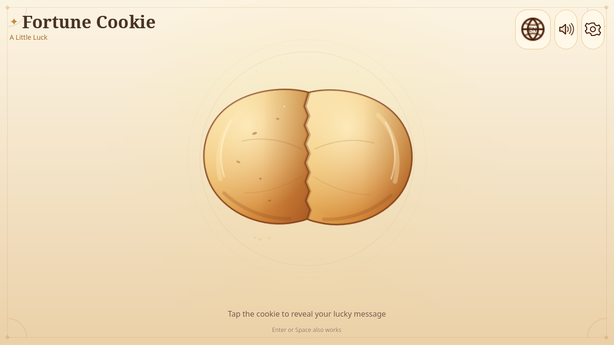
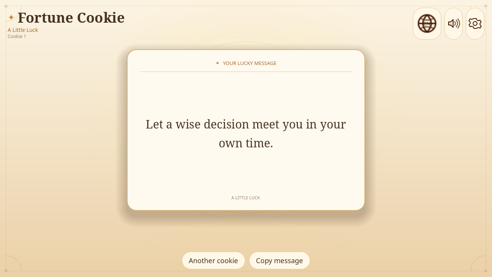
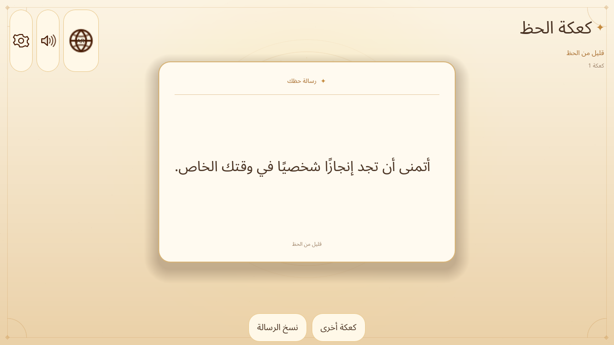
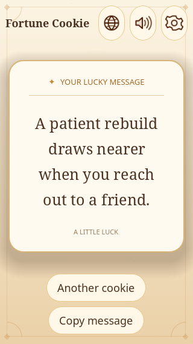

# Fortune Cookie: A Little Luck

A polished, offline-first 2D fortune-cookie game built with **Godot 4.7.2** and GDScript.
A hand-drawn cookie floats at the centre of a warm parchment scene. Click, tap, press
Enter, or press Space: the shell compresses, cracks into two independently tumbling
halves, scatters a bounded burst of crumbs and golden sparkles, and a fortune slip
unfolds with an uplifting localised message.

| Idle | Fortune |
|---|---|
|  |  |

| Arabic RTL | Small phone |
|---|---|
|  |  |

## Highlights

- **Native Godot 4** desktop/mobile game; no web runtime, server, database, or runtime AI.
- **30 languages**, including Arabic, Urdu, Persian and Hebrew RTL layouts.
- **68,911 unique validated fortunes** — every locale has at least 2,000.
- **Unlimited cracking** with a deterministic state machine and no per-crack node growth.
- **Shuffled no-repeat selection** with bounded recent-history protection.
- **Original vector artwork**, custom-drawn parchment background, and original WAV SFX.
- **Reduced-motion** and **low-effects** accessibility modes.
- **Persistent settings** in `user://`, corrupt-settings recovery, and a testable clipboard
  wrapper.
- **Responsive UI** checked at 320×568, 375×812, 390×844, 768×1024, 1280×720,
  1440×900 and 1920×1080.
- **59.5 FPS average** at 1920×1080 on an Intel Iris Xe (vsync; 9 frames >20 ms in sample).

## Quick start

```bash
# Verified environment: Ubuntu 26.04.1, x86_64, Godot 4.7.2
make env          # environment check
make run          # launch the game from source
make test         # content validation + headless integration suite
make build        # debug Linux executable
make release      # tests, release export, content verification, ZIP
make clean        # remove build outputs and Godot import cache
```

Run `make help` for all targets and options. You can override Godot or launch
arguments:

```bash
make GODOT=/path/to/godot run
make run ARGS="--position 40,40"
```

The underlying scripts remain available directly:

```bash
./scripts/check-dev-env.sh
./scripts/run-game.sh
./scripts/test.sh
./scripts/export-linux.sh
./builds/linux/FortuneCookie.x86_64
```

Manual commands if you prefer:

```bash
godot --path .
godot --headless --path . --editor --quit
godot --headless --path . res://tests/test_runner.tscn
godot --headless --path . --export-release "Linux" builds/linux/FortuneCookie.x86_64
./builds/linux/FortuneCookie.x86_64 --headless --verify-content
```

See [docs/UBUNTU_SETUP.md](docs/UBUNTU_SETUP.md) for the verified toolchain and setup,
[docs/QA_CHECKLIST.md](docs/QA_CHECKLIST.md) for test evidence and manual checks, and
[docs/PACKAGING.md](docs/PACKAGING.md) for desktop/mobile export steps.

## Controls

| Input | Action |
|---|---|
| Click / tap the cookie | Crack the cookie and reveal a fortune |
| Enter / Space | Same, when no UI control is focused |
| Tab | Move focus; the cookie itself is an accessible focus target |
| Another cookie | Dismiss the slip and reset the shell |
| Copy message | Copy the active fortune to the clipboard |
| Speaker button / Settings | Sound, language, reduced motion, low effects |
| Escape | Close the language or settings sheet |
| Ctrl+C while a fortune is shown | Copy the fortune |

No feature requires hover.

## Languages

English, Spanish, Mandarin Chinese, Hindi, Arabic, French, Portuguese, Bengali, Russian,
Indonesian, Urdu, German, Japanese, Nigerian Pidgin, Marathi, Telugu, Turkish, Tamil,
Vietnamese, Korean, Italian, Thai, Persian, Swahili, Hausa, Yoruba, Dutch, Polish,
Filipino and Hebrew.

The selector shows country-suggested flags alongside native and English names. Flag
mapping is configurable in `data/locales.json`; flags are suggestions, not claims that a
language belongs to one country. The OS locale is used on first launch when supported.

Per-locale validated counts are in [reports/fortune-validation.md](reports/fortune-validation.md).
Totals: **68,911 records**, **zero exact duplicates**, **161 near-duplicate pairs**
flagged for editorial review, **zero validation failures**.

## Architecture

```text
project.godot
Makefile                   clean/build/run/release developer commands
scenes/
  main.tscn
  cookie/fortune_cookie.tscn
  cookie/shell_piece.tscn
  ui/game_ui.tscn
  ui/fortune_slip.tscn
  ui/settings_panel.tscn
  ui/language_selector.tscn
scripts/
  main.gd                  scene coordination, layout, input, lifetime
  fortune_cookie.gd        explicit crack/reset state machine
  animation_controller.gd  shell + particle choreography
  fortune_manager.gd       locale loading, shuffled bag, bounded no-repeat history
  localization_manager.gd  locale metadata, Translation resources, RTL, fonts
  settings_manager.gd      atomic settings + corrupt-file recovery
  audio_manager.gd         four original one-shot SFX; no autoplay
  clipboard_service.gd     testable clipboard wrapper
  background.gd            custom-drawn parchment scene
  ambient_sparkles.gd      fixed-count ambient sparkles
  effects_controller.gd    reusable bounded GPU particles + golden ring
  ui_theme.gd              cream/gold/parchment visual system
  ui/…                     responsive UI components
data/
  locales.json             30 locale records, flags, RTL and font groups
  ui/<locale>.json         42 interface strings per locale
  fortunes/<locale>.json   stable-id fortune records
tools/
  validate_fortunes.py     content + interface validation and reports
  generate_fortunes.py     English source and optional build-time translation
  build_pair_fortunes.py   fallback phrase-bank composition
  translate_nllb.py        build-time-only local NLLB phrase-bank translation
  generate_audio.py        original WAV synthesis
tests/
  test_runner.tscn/.gd     398 integration assertions
  screenshot.tscn/.gd      graphical QA captures
  performance_probe.*      1920×1080 vsync measurement
  clipboard_probe.*        Wayland clipboard round-trip
docs/
```

### State machine

`IDLE → ANTICIPATION → CRACKING → FORTUNE_REVEAL → FORTUNE_DISPLAY → RESETTING → IDLE`

Every transition is checked. Only `IDLE` accepts a crack request. A duplicate-input
guard (180 ms) plus state/sequence guards prevent overlapping animations. The two
shell pieces and two particle systems are created once and reused; a long session does
not accumulate nodes.

### Selection

`FortuneManager` loads only the requested locale, caches parsed data, shuffles an index
bag, and maintains a 64-entry recent window. Immediate repeats are blocked and recent
repeats are retried. Refills are shuffled and safe. A missing/malformed locale falls back
to a localised positive message and a development error, never an empty slip.

### Persistence

`user://settings.json` stores language, sound, reduced motion and low effects. Writes are
atomic (`.tmp` then rename). Corrupt files are quarantined as `.corrupt` and defaults are
restored without crashing.

## Validation and tests

```bash
python3 tools/validate_fortunes.py
godot --headless --path . res://tests/test_runner.tscn
```

Latest results:

- Content validator: **PASS**, 68,911 unique, 0 failures, 25 advisory warnings
  (one per locale containing a flagged near-duplicate pair).
- Godot integration suite: **398 passed, 0 failed**.
- Clipboard round-trip on Wayland: **PASS**.
- Graphical performance probe: **59.5 FPS average** at 1920×1080, 118 nodes, 139 draw
  calls in the final frame.
- Linux export: launched headlessly; `--verify-content` reports all 30 locales load from
  the packed build with 68,911 records.

The headless suite intentionally exercises malformed JSON and corrupt settings, so its
log contains expected error/warning lines from those negative tests. The process exits 0.
Godot also prints a benign shutdown notice about two ObjectDB instances and one resource
when the test runner quits; the normal game and exported binary exit without that notice.

## Content pipeline and review

The game never makes a network request. English and Nigerian Pidgin sources were
composed locally. Nine locale libraries were seeded with a build-time translation pass;
nineteen locales use 2,100 two-sentence fortunes composed from 150 curated, locally
translated sentences. That fallback exists because the first bulk translation service
throttled; it is documented rather than hidden. All non-English text is marked for
fluent-speaker review in [docs/LOCALIZATION_REVIEW.md](docs/LOCALIZATION_REVIEW.md).
No fortunes promise financial returns, medical outcomes, or genuine prediction.

## Export

The Linux x86_64 export is tested. Windows, macOS, Android and iOS are documented with
prerequisites; they were not built here. iOS requires macOS and Xcode. See
[docs/PACKAGING.md](docs/PACKAGING.md).

## Known limitations

- Visual QA was done via graphical screenshots at seven resolutions on this machine;
  no physical touchscreen or mobile device was available.
- Touch and keyboard are exercised by integration tests, but physical touch feel and
  screen-reader behaviour still need device testing.
- Non-English content requires fluent-speaker review. NLLB/Google-assisted drafting is
  noted in the review document.
- Windows/macOS/Android/iOS builds and signing were not executed here.
- The clipboard failure path is tested headlessly; the success path was verified on
  Wayland. A locked/denied clipboard environment still shows a safe message.
- Sound files and playback paths are verified, but no listening test with a calibrated
  audio device was performed.

## License

**MIT License** — see [LICENSE](LICENSE).

Copyright (c) 2026 Fortune Cookie: A Little Luck contributors

Permission is hereby granted, free of charge, to any person obtaining a copy of this
software and associated documentation files (the "Software"), to deal in the Software
without restriction, including without limitation the rights to use, copy, modify, merge,
publish, distribute, sublicense, and/or sell copies of the Software, subject to the
conditions in the [LICENSE](LICENSE) file.

This MIT license applies to:

- the GDScript game and UI code,
- Python validation and content tooling,
- shell developer scripts,
- Godot tests and test scenes,
- original SVG artwork, original WAV audio and the original game content.

All GDScript, Python and shell source files, plus the Makefile, carry an
`SPDX-License-Identifier: MIT` header.

Third-party components retain their own licenses:

- **Godot Engine 4.7.2:** MIT. Its copyright notice is included at
  [docs/GODOT_COPYRIGHT.txt](docs/GODOT_COPYRIGHT.txt).
- **Noto fonts:** SIL Open Font License 1.1, retained at
  [assets/fonts/LICENSE-NOTO.txt](assets/fonts/LICENSE-NOTO.txt).
- Build-time translation models and services are noted in
  [docs/ASSET_LICENSES.md](docs/ASSET_LICENSES.md); they are not runtime dependencies.

## Credits

- Engine: Godot 4.7.2.
- Fonts: the Noto family, embedded for offline multilingual support.
- Artwork, audio, game code and original content: made for this project.
